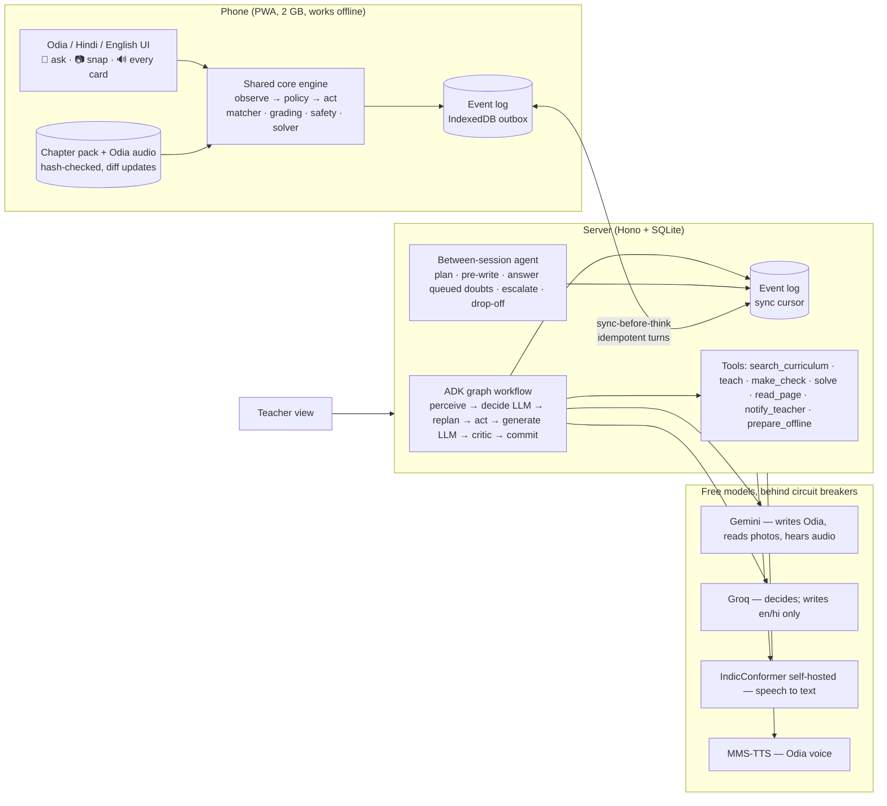

# Setu — mid-evaluation package

**Sunita has the family phone for one hour a day. Setu's work doesn't stop when she puts it down.**

## Problem

Sunita is in Class 9 in a rural block of Odisha. She studies in Odia, the exam terms are English, and her doubts come in the evening on a shared phone with a weak signal and a small data pack. Her teacher has no time left for her doubts.

> She has a phone and an Odia textbook, but nobody who can answer her doubt in her language, check whether she understood, tell her what to study next, and keep going when the signal drops — so she memorises what she doesn't understand.

## Users

| User | Needs | What Setu does |
|---|---|---|
| Learner (primary) | Ask in her own way; understand, not memorise; work offline; little data | She asks by voice, in English letters, or by photographing the textbook line. Setu answers at her reading level and checks with a question. It finds the misconception behind a wrong answer and tries a different way. It keeps teaching offline. |
| Teacher (secondary) | Only what needs a human | She sees who is stuck, with the evidence. She also gets a class reteach draft for a misconception several learners share, a separate wellbeing list, and drop-off. |

## Architecture

## How the loop runs

1. **Trigger.** Her question, her answer, a session opening or ending, a signal change, or the daily schedule.
2. **Perceive.** Her offline events sync first. Then the question is matched against her textbook, graded, and screened for safety.
3. **Decide.** The deterministic policy ranks candidate actions by her mastery, misconceptions, prerequisites, goal, time and data. The LLM may choose differently only with a stated reason, and that choice is validated.
4. **Replan once** if the observation contradicts the choice (a weak prerequisite, nothing in the book).
5. **Act.**
   - Explain (generated from her textbook, or a reviewed pack text), then a check.
   - Or a solver-backed hint ladder for homework.
   - Or a caring message with helplines.
6. **Critic.** Script, terms, numbers re-checked by the solver, citations, reading level, answer leak and safety. A failure gets one revision; if that fails too, the reviewed text is used.
7. **Commit.** Events are stored before anything is shown. Her next answer is the next observation.
8. **Between sessions.** Plan tomorrow, pre-write it, prefetch within her data budget, answer her queued doubts, tell the teacher what needs a human.

The same engine runs on the phone without models when there is no signal.

## Status at mid-evaluation

| Area | State |
|---|---|
| Agent loop (phone + server) | Built, traced live at `/trace/live`, golden replay of real model replies in CI |
| Odia: text, romanized, code-mixed, speech, photo | Built; speech-to-text self-hosted (≈2 s); photo locates the textbook passage |
| Offline | Device tier, outbox sync, idempotent turns, prepared sessions, pack sharing by file |
| Teacher | Class + QR join, needs-you with evidence, class reteach draft, wellbeing, drop-off |
| Safety | Distress/unsafe/off-topic/personal screen, output guard, PII scrub; red-team 30/30 |
| Evaluation | Simulator (agent vs plain tutor), 50-doubt understanding set, red-team, golden, sync properties — in CI |

## Planned bonuses

- **Teacher-added home-language words** (Kui, Santali, Ho) in the term bridge (built).
- **One-tap Hindi** for the same learner (built; Hindi pack drafted, review pending).
- **Opt-in "next lesson ready" reminders** (built; delivery untested on a phone).
- **Phone-to-phone lesson sharing** for a friend with no data (built).
- **Field test** with 3–5 students (needs consent and a school).
